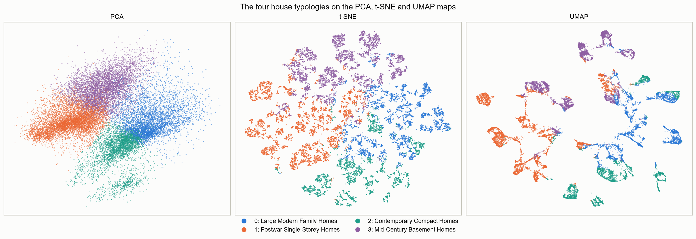
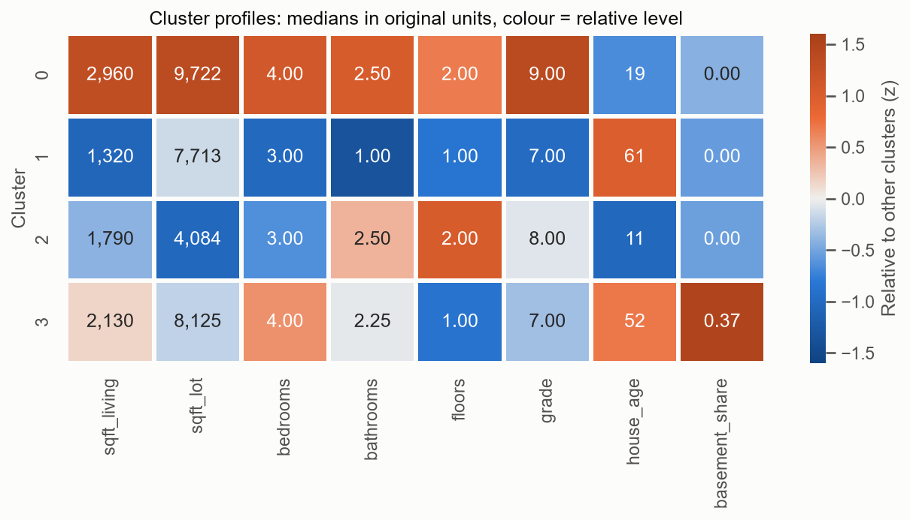
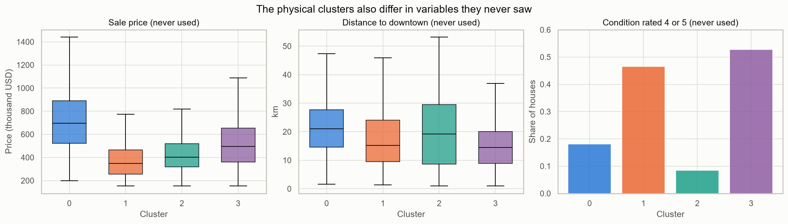

# Housing typologies in King County (WA)

**Team:** Karthikeyan Saravanan, Emmanuel Marquez, Bars Babila, Samiha Abeda Nur
**Course:** AI Methods I – Day 3: Unsupervised learning (IAAC MaAI 2026/27)
**Dataset on Hugging Face:** [datasets/iaac-maai/day3-group2-king-county-house-typologies](https://huggingface.co/datasets/iaac-maai/day3-group2-king-county-house-typologies)
**Model on Hugging Face:** [iaac-maai/day3-group2-house-typologies](https://huggingface.co/iaac-maai/day3-group2-house-typologies)

## Use case

A county housing or planning department designing programmes for the existing housing stock (retrofit, ageing-in-place, density incentives) cannot write one policy for every house. This project groups King County's houses into **physical typologies**, based only on the building and its plot. Price and location are kept out of the clustering and used afterwards to check the groups. A group is useful if it can be named as a recognisable type of house and has a clear size, age and location that a programme can target.

## Dataset

| | |
|---|---|
| **Name** | House Sales in King County, USA |
| **Source** | [Kaggle: harlfoxem/housesalesprediction](https://www.kaggle.com/datasets/harlfoxem/housesalesprediction), cleaned in our [Day 2 repository](https://github.com/iaac-maai/2-day2-assignment) |
| **Our version** | [day3-group2-king-county-house-typologies](https://huggingface.co/datasets/iaac-maai/day3-group2-king-county-house-typologies) (CC BY 4.0): 20,555 houses with engineered features, `cluster`, `cluster_name` and map coordinates |
| **Coverage** | Home sales in King County, Washington (which includes Seattle), May 2014 to May 2015 |
| **Rows used** | 20,555 (one row = one house): 20,703 cleaned sales minus 148 repeat sales of the same house |
| **Licence** | CC0: Public Domain (as stated on Kaggle) |

## Repository structure

```
├── data/          # cleaned Day 2 CSV, downloaded by the notebook on the first run
├── dataset/       # dataset card (README.md) + its 2 figures; the CSV lives only on Hugging Face
├── figures/       # 12 plots exported by the notebook (00 to 11)
├── models/        # model card (README.md); model.joblib lives only on Hugging Face
├── notebook/      # unsupervised_learning.ipynb: the whole analysis, sections 0 to 8
├── .gitignore
├── LICENSE
├── README.md
└── requirements.txt
```

## How to run

Python 3.12 is recommended.

```bash
python -m venv .venv
source .venv/bin/activate        # Windows: .venv\Scripts\activate
pip install -r requirements.txt
```

Open `notebook/unsupervised_learning.ipynb`, select the `.venv` kernel and run all cells. Run it from the `notebook/` folder, because all paths are relative to it. The cleaned data is downloaded automatically into `data/` the first time. The whole notebook takes about 3–4 minutes on a laptop (t-SNE and UMAP are the slowest steps). At the end it writes `models/model.joblib` and `dataset/king_county_house_typologies.csv`, which are uploaded to Hugging Face (they are not committed to GitHub).

To use the published model without running the notebook, see the "How to use" section of the [model card](models/README.md).

## Approach

- **Unit of analysis:** one row = one house. We keep the latest sale of each of the 148 houses sold twice, none of which changed physically between sales.
- **Features clustered on:** `sqft_living`, `sqft_lot`, `bedrooms`, `bathrooms`, `floors`, `grade`, `house_age`, `basement_share`. These define "similar" as similar as a building.
- **Kept aside for interpretation:** price (`price`, `price_per_sqft`), location (`lat`, `long`, `zipcode`, `dist_downtown_km`), street context (`sqft_living15`, `sqft_lot15`, `living_vs_neighbours`, `lot_coverage`) and state (`condition`, `renovated`, `yr_renovated`, `years_since_work`).
- **Engineered features:** `sale_year`, `sale_month`, `house_age`, `renovated`, `years_since_work`, `basement_share`, `lot_coverage`, `living_vs_neighbours`, `price_per_sqft`, `dist_downtown_km`.
- **Preprocessing:** a scikit-learn `Pipeline` with log10 on `sqft_living` and `sqft_lot` (the skew of `sqft_lot` falls from 13.01 to 0.95) and `StandardScaler` on all 8 features, as they have different units. No categorical column is clustered on.
- **Dimensionality reduction:** PCA, t-SNE (`perplexity=30`) and UMAP (`n_neighbors=30`, `min_dist=0.1`).
- **Clustering:** K-Means (k = 2 to 9, on all houses) and Ward hierarchical clustering (on a fixed sample of 2,000 houses, as it does not scale to 20,555). Neither the elbow nor the silhouette gives a clear k: the silhouette is best at k = 2 (0.278) and only slightly lower at k = 4 (0.264). We chose **k = 4**, because k = 3 merges the large modern homes with the compact new-builds, and k = 2 only separates old from new.
- **Agreement and stability:** K-Means and Ward agree moderately (ARI 0.580 on the same 2,000 houses). K-Means is very stable: ARI 0.991–1.000 over five random seeds and 0.976–0.997 on five 80% subsamples.
- **Final model:** K-Means (k = 4) inside one `Pipeline` with the log and the scaler. It is stable, uses every house, and can assign new houses with `.predict()`, so no extra assigner model is needed.

**What the dimensionality reduction found:**

- The data has about **3 to 4 real dimensions**. Three components have an eigenvalue above 1 (76.0% of the variance) and four reach 84.2%. The PCA map shows 63.2%.
- **PC1 (42.2%) is "how much house"** (size, bathrooms, grade, newer), and is the axis linked to price (Spearman 0.54), which it never saw. **PC2 (21.0%) is building form:** older low-rise houses with a basement against newer multi-storey houses without one. **PC3 (12.8%) is the plot**, and follows distance to downtown (0.48).
- PCA shows a **continuous cloud** with two touching lobes and one small tail: 697 houses (3.4%) with a median of 3 floors on a 1,250 sqft plot, 7 years old, 8.4 km from downtown.
- t-SNE and UMAP show many islands, but **most are combinations of discrete values**. A house and its nearest neighbour on the t-SNE map share the same bedrooms in 99.5% of cases (34.5% by chance) and the same floors in 98.5% (39.7% by chance). We therefore use these maps for display only.


## Results

Four physical house typologies, named by the team from the profiles and the cross-tabs in section 5 of the notebook (medians):

| Cluster | Name | Houses (share) | Defining features |
|---|---|---|---|
| 0 | **Large Modern Family Homes** | 4,728 (23.0%) | 2,960 sqft, 4 bedrooms, 2.5 bathrooms, grade 9, 2 storeys, built around 1995. Median price $695k, 21 km from downtown (Eastside suburbs) |
| 1 | **Postwar Single-Storey Homes** | 6,467 (31.5%) | 1,320 sqft, 1 bathroom, grade 7, 79% single-storey, built around 1953. Cheapest (median $350k), mostly inner north Seattle |
| 2 | **Contemporary Compact Homes** | 3,940 (19.2%) | Built around 2004, 2–3 storeys, smallest plot (4,084 sqft). Both urban townhouse infill (a third of the group) and new outer subdivisions |
| 3 | **Mid-Century Basement Homes** | 5,420 (26.4%) | 97% have a basement (a third of the living space), 84% single-storey, 4 bedrooms, built around 1962. Median $495k, 14 km from downtown |

**Main findings:**

- The types follow the first two PCA axes: *how much house* (cluster 0 against cluster 1) and *building form* (basement houses in cluster 3 against multi-storey new-builds in cluster 2).
- Price and location were never used, but they differ clearly between the types: the median price goes from $350k (cluster 1) to $695k (cluster 0). Price per square foot, however, is almost the same in every type ($233–270), because it depends on location, not on the building.
- For a planning department: **58% of the stock** (clusters 1 and 3) is a single-storey house built around 1950–1965, mostly within 15 km of downtown. These are the natural targets of a retrofit or ageing-in-place programme.







## Limitations

- **Period and place:** the data covers sales in King County in 2014–2015. It says nothing about other regions, and prices and the stock have changed since.
- **Sold homes only:** houses that did not sell during that year are missing, so this is a sample of the stock, not a census.
- **Inherited cleaning:** extreme prices, areas and bedroom counts were removed on Days 1 and 2, as were the `waterfront` and `view` columns, so the most unusual houses are under-represented.
- **Coded and approximate variables:** `grade` is an assessor's scale, not a physical measurement. `lot_coverage` is a rough estimate (4 rows exceed 1). 11 homes were sold before completion, so their age is set to 0.
- **Weak separation:** the PCA map suggests a continuum, so group boundaries are partly a choice. The structure on the t-SNE and UMAP maps largely reflects discrete values, and sizes and distances on those maps are not meaningful.
- **The clusters are one reading of a continuum:** the silhouette is low (0.264) and the PCA map shows touching groups. k = 4 is a choice, and houses near a border could easily belong to the neighbouring type. The stability tests keep features, preprocessing and k fixed, so they do not test those choices.
- **Algorithm comparison on a sample:** Ward was fitted on 2,000 houses only, so its agreement with K-Means (ARI 0.580) is a sample comparison.
- **Cluster 2 mixes two contexts** (urban townhouses and new suburban houses); a programme that needs to treat them differently should split it by plot size or location.
- **Privacy:** before publishing we removed the parcel `id` and rounded `lat` / `long` to 3 decimals (about 100 m).
- **What the clusters should not be used for:** predicting price, energy performance or structural safety, or classifying houses from other regions or outside the ranges of the data.

## AI usage disclosure

| | |
|---|---|
| **Tools** | Claude Code (agent) for sections 0–2; Claude (agent) for sections 5–8, the model card and the dataset card. |
| **Why** | To speed up the coding and the first drafts of the text, so that the team could spend its time on the decisions: the use case, which features define "similar", the choice of k and the names of the clusters |
| **Where** | Code and first drafts of the readings in sections 0–2 and 5–8, figures 09–11, `models/README.md`, `dataset/README.md` and parts of this README. The choice of k = 4 and the final cluster names were decided by the team |
| **How** | Sections 0–2, prompt: *"Add only sections 0, 1 and 2 to the notebook and prepare the README. Do not touch sections 3 to 8. Use relative paths and explain each step in markdown. Interpretations must be based on real notebook results."* **Cluster names:** the agent first suggested descriptive draft names, which we used as a starting point. We then rewrote them as a team to make them shorter, clearer and more focused on the main architectural characteristics of each cluster, checking each one against the profile table and the cross-tabs. We asked the agent for feedback on our version, and adjusted two of the names after it (Large Modern Family Homes, Postwar Single-Storey Homes); the other two are our own (Contemporary Compact Homes, Mid-Century Basement Homes). Asserts in the notebook make sure that a name cannot silently go to the wrong cluster. We published the dataset and the model on Hugging Face ourselves and tested that the model loads and assigns a cluster in a fresh folder |

**Lessons learned:** The agent was fast at writing code and first drafts, but it could not decide for us: whether k = 3 or k = 4 is better, or whether a name is fair, depends on the use case. It was most useful as a critic: its feedback on our cluster names made two of them clearer. A clear hand-off table at the end of each section made it easy for team members and the agent to continue each other's work.

## License

Code and model released under the [MIT License](LICENSE). The original data is CC0 (public domain); our clustered dataset on Hugging Face is released under CC BY 4.0.
