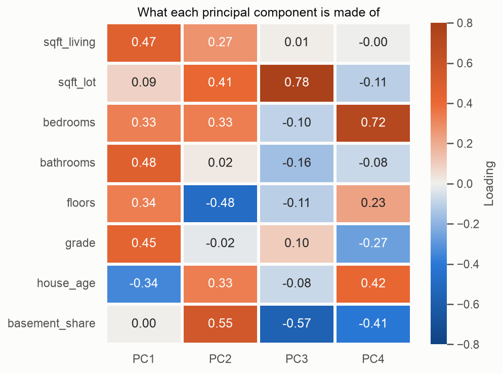
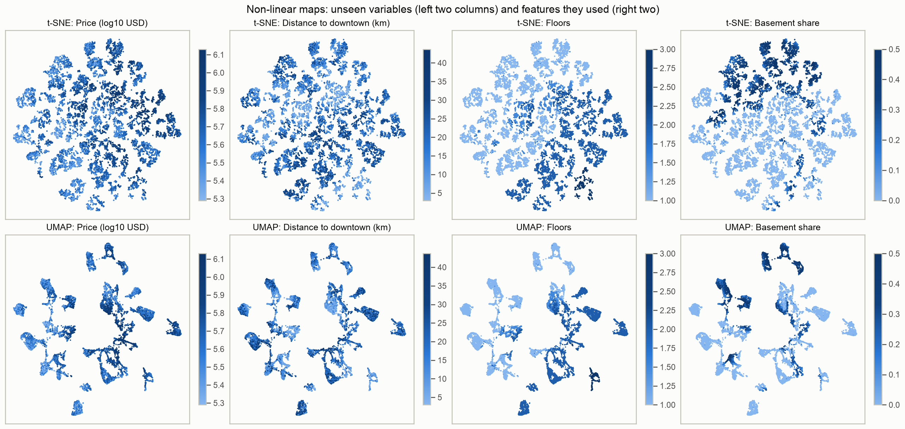

# Housing typologies in King County (WA)

**Team:** Karthikeyan Saravanan, Emmanuel Marquez, Bars Babila, Samiha Abeda Nur
**Course:** AI Methods I – Day 3: Unsupervised learning (IAAC MaAI 2026/27)
**Dataset on Hugging Face:** TODO (Person 4): `https://huggingface.co/datasets/iaac-maai/<dataset-repo>`
**Model on Hugging Face:** TODO (Person 4): `https://huggingface.co/iaac-maai/<model-repo>`

## Use case

A county housing or planning department designing programmes for the existing housing stock (retrofit, ageing-in-place, density incentives) cannot write one policy for every house. This project groups King County's houses into **physical typologies**, based only on the building and its plot. Price and location are kept out of the clustering and used afterwards to check the groups. A group is useful if it can be named as a recognisable type of house and has a clear size, age and location that a programme can target.

## Dataset

| | |
|---|---|
| **Name** | House Sales in King County, USA |
| **Source** | [Kaggle: harlfoxem/housesalesprediction](https://www.kaggle.com/datasets/harlfoxem/housesalesprediction), cleaned in our [Day 2 repository](https://github.com/iaac-maai/2-day2-assignment) |
| **Our version** | TODO (Person 4): Hugging Face link |
| **Coverage** | Home sales in King County, Washington (which includes Seattle), May 2014 to May 2015 |
| **Rows used** | 20,555 (one row = one house): 20,703 cleaned sales minus 148 repeat sales of the same house |
| **Licence** | CC0: Public Domain (as stated on Kaggle) |

## Repository structure

```
├── data/          # cleaned Day 2 CSV, downloaded by the notebook on the first run
├── dataset/       # dataset card (README.md) + its figures; the data lives on Hugging Face
├── figures/       # plots exported by the notebook
├── models/        # model card (README.md); model.joblib lives on Hugging Face
├── notebook/      # unsupervised_learning.ipynb: the whole analysis
├── .gitignore
├── LICENSE
├── README.md
└── requirements.txt
```

## How to run

Python 3.12 is recommended.

```bash
python -m venv .venv
source .venv/bin/activate        # Windows: .venv\Scripts\activate
pip install -r requirements.txt
```

Open `notebook/unsupervised_learning.ipynb`, select the `.venv` kernel and run all cells. Run it from the `notebook/` folder, because all paths are relative to it. The cleaned data is downloaded automatically into `data/` the first time. Sections 0–2 take about a minute on a laptop.

## Approach

- **Unit of analysis:** one row = one house. We keep the latest sale of each of the 148 houses sold twice, none of which changed physically between sales.
- **Features clustered on:** `sqft_living`, `sqft_lot`, `bedrooms`, `bathrooms`, `floors`, `grade`, `house_age`, `basement_share`. These define "similar" as similar as a building.
- **Kept aside for interpretation:** price (`price`, `price_per_sqft`), location (`lat`, `long`, `zipcode`, `dist_downtown_km`), street context (`sqft_living15`, `sqft_lot15`, `living_vs_neighbours`, `lot_coverage`) and state (`condition`, `renovated`, `yr_renovated`, `years_since_work`).
- **Engineered features:** `sale_year`, `sale_month`, `house_age`, `renovated`, `years_since_work`, `basement_share`, `lot_coverage`, `living_vs_neighbours`, `price_per_sqft`, `dist_downtown_km`.
- **Preprocessing:** a scikit-learn `Pipeline` with log10 on `sqft_living` and `sqft_lot` (the skew of `sqft_lot` falls from 13.01 to 0.95) and `StandardScaler` on all 8 features, as they have different units. No categorical column is clustered on.
- **Dimensionality reduction:** PCA, t-SNE (`perplexity=30`) and UMAP (`n_neighbors=30`, `min_dist=0.1`).
- **Clustering:** TODO (Person 2): algorithms compared, choice of k, agreement and stability; final choice and why.

**What the dimensionality reduction found:**

- The data has about **3 to 4 real dimensions**. Three components have an eigenvalue above 1 (76.0% of the variance) and four reach 84.2%. The PCA map shows 63.2%.
- **PC1 (42.2%) is "how much house"** (size, bathrooms, grade, newer), and is the axis linked to price (Spearman 0.54), which it never saw. **PC2 (21.0%) is building form:** older low-rise houses with a basement against newer multi-storey houses without one. **PC3 (12.8%) is the plot**, and follows distance to downtown (0.48).
- PCA shows a **continuous cloud** with two touching lobes and one small tail: 697 houses (3.4%) with a median of 3 floors on a 1,250 sqft plot, 7 years old, 8.4 km from downtown.
- t-SNE and UMAP show many islands, but **most are combinations of discrete values**. A house and its nearest neighbour on the t-SNE map share the same bedrooms in 99.5% of cases (34.5% by chance) and the same floors in 98.5% (39.7% by chance). We therefore use these maps for display only.





## Results

TODO (Persons 2 and 3): complete with the final clusters. The table must come from section 5 of the notebook.

| Cluster | Name | Size | Defining features |
|---|---|---|---|
| TODO | TODO | TODO | TODO |

TODO (Person 2 or 3): embed the figure of the clusters in 2D.

## Limitations

- **Period and place:** the data covers sales in King County in 2014–2015. It says nothing about other regions, and prices and the stock have changed since.
- **Sold homes only:** houses that did not sell during that year are missing, so this is a sample of the stock, not a census.
- **Inherited cleaning:** extreme prices, areas and bedroom counts were removed on Days 1 and 2, as were the `waterfront` and `view` columns, so the most unusual houses are under-represented.
- **Coded and approximate variables:** `grade` is an assessor's scale, not a physical measurement. `lot_coverage` is a rough estimate (4 rows exceed 1). 11 homes were sold before completion, so their age is set to 0.
- **Weak separation:** the PCA map suggests a continuum, so group boundaries are partly a choice. The structure on the t-SNE and UMAP maps largely reflects discrete values, and sizes and distances on those maps are not meaningful.
- TODO (Persons 2 and 3): limitations of the clusters (choice of k, stability, what they should not be used for).

## AI usage disclosure

TODO (each team member): add your own use of AI to this table. What follows covers sections 0–2 and this README.

| | |
|---|---|
| **Tools** | Claude Code (agent). It edited files and ran code by itself |
| **Why** | To read the brief and the class notebook, build sections 0–2 of the notebook and prepare the README |
| **Where** | Feature engineering, preprocessing, PCA, t-SNE and UMAP code, figures, draft interpretations, this README |
| **How** | Prompt: *"Add only sections 0, 1 and 2 to the notebook and prepare the README. Do not touch sections 3 to 8. Use relative paths and explain each step in markdown. Interpretations must be based on real notebook results."* The agent ran the notebook first and wrote the readings afterwards from the outputs and figures. When the t-SNE and UMAP islands looked like discrete values, it measured this with a nearest-neighbour check, which is now in the notebook |

**Lessons learned:** TODO (team).

## License

Code released under the [MIT License](LICENSE). The dataset is subject to its own licence (see above).
